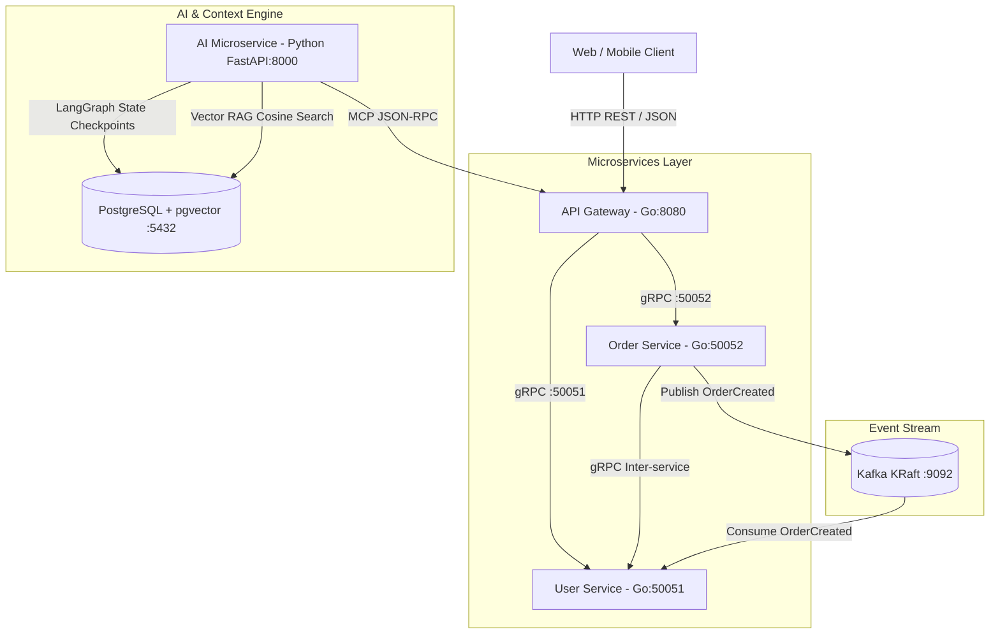

# Enterprise Omnichannel AI Support Hub

Welcome to the **Enterprise Omnichannel AI Support Hub**! This is a production-ready, highly scalable distributed system built from scratch. It integrates e-commerce microservices with an advanced, stateful AI Support Agent using **Go**, **gRPC**, **Kafka (KRaft)**, **Python/FastAPI**, **LangGraph**, **PostgreSQL (`pgvector`)**, and **Model Context Protocol (MCP)**.

---

## 🏗️ Architecture & Component Topology



---

## 📁 Monorepo Structure & Service Documentation

| Directory / Module | Stack | Description | Documentation |
| :--- | :--- | :--- | :--- |
| **[api-gateway](file:///Users/milanpreetsingh/Desktop/enterprise-ai-system/api-gateway)** | Go (Gin) | Reverse proxy, JWT authentication middleware, REST-to-gRPC translation, and MCP Server endpoint. | [api-gateway/README.md](file:///Users/milanpreetsingh/Desktop/enterprise-ai-system/api-gateway/README.md) |
| **[services/user](file:///Users/milanpreetsingh/Desktop/enterprise-ai-system/services/user)** | Go (gRPC, GORM) | User registration, authentication, JWT issuance, and Kafka consumer group listener. | [services/user/README.md](file:///Users/milanpreetsingh/Desktop/enterprise-ai-system/services/user/README.md) |
| **[services/order](file:///Users/milanpreetsingh/Desktop/enterprise-ai-system/services/order)** | Go (gRPC, GORM) | Order creation, status lookups, inter-service gRPC validation, and idempotent Kafka producer. | [services/order/README.md](file:///Users/milanpreetsingh/Desktop/enterprise-ai-system/services/order/README.md) |
| **[services/inventory](file:///Users/milanpreetsingh/Desktop/enterprise-ai-system/services/inventory)** | Go (Kafka, GORM) | Event-driven stock management, idempotent restock consumer, and Dead Letter Queue (DLQ). | [services/inventory/README.md](file:///Users/milanpreetsingh/Desktop/enterprise-ai-system/services/inventory/README.md) |
| **[services/notification](file:///Users/milanpreetsingh/Desktop/enterprise-ai-system/services/notification)** | Python (Kafka, SMTP) | Asynchronous email dispatcher, idempotent event inbox, and DLQ error recovery. | [services/notification/README.md](file:///Users/milanpreetsingh/Desktop/enterprise-ai-system/services/notification/README.md) |
| **[services/ai](file:///Users/milanpreetsingh/Desktop/enterprise-ai-system/services/ai)** | Python (FastAPI, LangGraph) | Stateful AI support agent, Postgres conversation checkpointer, `pgvector` RAG, and MCP Client. | [services/ai/README.md](file:///Users/milanpreetsingh/Desktop/enterprise-ai-system/services/ai/README.md) |
| **[frontend-app](file:///Users/milanpreetsingh/Desktop/enterprise-ai-system/frontend-app)** | HTML5, CSS3, JS | Responsive omnichannel chat dashboard with SSE streaming and MCP tool visualization. | [frontend-app/README.md](file:///Users/milanpreetsingh/Desktop/enterprise-ai-system/frontend-app/README.md) |
| **[proto-schemas](file:///Users/milanpreetsingh/Desktop/enterprise-ai-system/proto-schemas)** | Proto3 | Centralized gRPC Protocol Buffer definitions and code generation stubs. | [proto-schemas/README.md](file:///Users/milanpreetsingh/Desktop/enterprise-ai-system/proto-schemas/README.md) |
| **[infra](file:///Users/milanpreetsingh/Desktop/enterprise-ai-system/infra)** | Docker Compose | Local containerized infrastructure (PostgreSQL 16, Redis 7, Kafka KRaft). | [infra/README.md](file:///Users/milanpreetsingh/Desktop/enterprise-ai-system/infra/README.md) |
| **[docs](file:///Users/milanpreetsingh/Desktop/enterprise-ai-system/docs)** | Markdown | Implementation plans, step-by-step task logs, and architectural learning guides. | [learning.md](file:///Users/milanpreetsingh/Desktop/enterprise-ai-system/docs/learning.md), [kafka_guide.md](file:///Users/milanpreetsingh/Desktop/enterprise-ai-system/docs/kafka_guide.md) |

---

## ⚡ Quick Start: Running the Monorepo

### Step 1: Start Container Infrastructure
```bash
docker compose up -d
```

### Step 2: Sync Go Workspace Dependencies
```bash
go work sync && (cd api-gateway && go mod tidy) && (cd services/order && go mod tidy) && (cd services/user && go mod tidy) && (cd proto-schemas && go mod tidy)
```

### Step 3: Launch Microservices (Open 4 Terminal Windows)

```bash
# Terminal 1: User Service (gRPC :50051)
cd services/user && go run cmd/server/main.go

# Terminal 2: Order Service (gRPC :50052)
cd services/order && go run cmd/server/main.go

# Terminal 3: API Gateway (HTTP :8080)
cd api-gateway && go run main.go

# Terminal 4: AI Microservice (FastAPI :8000)
cd services/ai && source venv/bin/activate && uvicorn app.main:app --port 8000
```
