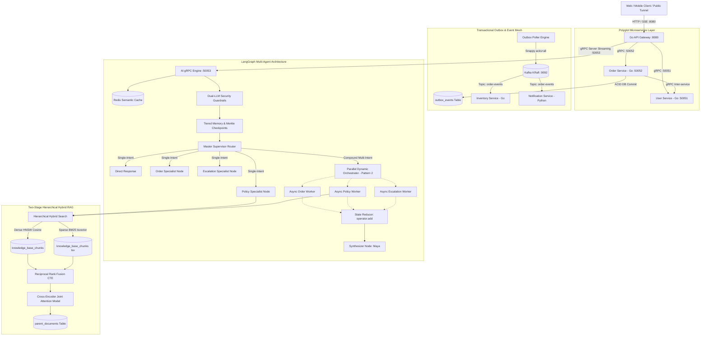

# Enterprise Omnichannel AI Support Hub

[](https://golang.org)
[](https://python.org)
[](https://kubernetes.io)
[](https://langchain-ai.github.io/langgraph/)
[-231F20?logo=apachekafka)](https://kafka.apache.org)
[](https://github.com/pgvector/pgvector)
[](https://grpc.io)

Welcome to the **Enterprise Omnichannel AI Support Hub**! This is an end-to-end, production-grade distributed system designed to handle complex e-commerce order lifecycles and customer support. It seamlessly pairs resilient microservices with an autonomous, stateful **Multi-Agent AI Support Hub** powered by **Go**, **gRPC**, **Kafka (KRaft)**, **FastAPI**, **LangGraph**, **pgvector**, **Hierarchical Hybrid RAG**, and the **Model Context Protocol (MCP)**.

The system is fully containerized with multi-stage Docker builds (<40MB Go binaries, PyTorch CPU-only wheels) and deployed on a multi-node **Kubernetes cluster** with Ingress, HPA auto-scaling, and zero-cost public internet exposure via **Cloudflare Tunnel**.

---

## 🏛️ Master System Architecture & Component Topology



---

## 🌟 Core Architecture & Capabilities

### 1. Dynamic Multi-Intent Orchestrator & Synthesizer (Pattern 2)
Handles compound inquiries (e.g. *"What is your return policy on opened electronics, and what is the status of order 2c78992d...?"*) using a 5-safeguard parallel orchestration architecture:
* **Conflict-Free Reducer:** Uses `Annotated[List[Dict], operator.add]` in `AgentState` so concurrent workers append without race conditions.
* **Zero-Latency Single-Intent Tax:** Stage 0 fast heuristic detector bypasses the planner in `<0.05ms` for simple single-intent queries.
* **Bulkhead Fault Isolation:** Wraps individual domain workers in `try...except` so a failure in the Order gRPC service does not crash the Policy lookup.
* **IDOR ContextVar Isolation:** `current_user_id.set(user_id)` bounds tenant credentials across concurrent asyncio coroutines.
* **Empathetic Fan-In Synthesis:** Combines partial and complete findings into Maya's unified customer response.

### 2. Two-Stage Hierarchical Hybrid RAG
* **Parent-Child Architecture:** Full legal policies are stored in `parent_documents`, while 100-word sentence-aligned chunks with 20-word overlap reside in `knowledge_base_chunks`.
* **Hybrid Search (Dense + Sparse):** Blends vector cosine distance (HNSW) and BM25 full-text rank (`tsvector` + GIN) via **Reciprocal Rank Fusion (RRF)**:
  $$\text{RRF Score} = \frac{1}{60 + \text{rank\_dense}} + \frac{1}{60 + \text{rank\_sparse}}$$
* **Cross-Encoder Re-Ranking:** Candidates are re-scored using joint-attention cross-encoders (`ms-marco-MiniLM-L-6-v2`) in `<20ms`, eliminating false positives before expanding to the parent document.

### 3. Distributed Event Streaming & SAGA Transactional Outbox
* **Zero Dual-Write Risk:** Order cancellations write to `orders` and `outbox_events` within **ONE ACID transaction**.
* **Outbox Poller Engine:** A background goroutine polls at 500ms intervals, publishing to Kafka with `acks=all` and Snappy compression.
* **Idempotent Consumer Groups:** Both Inventory and Notification services utilize `processed_events` deduplication tables with manual offset commits, guaranteeing exactly-once side-effects.

### 4. Human-in-the-Loop (HITL) Safety Breakpoints
* High-stakes state mutations (e.g., cancellations, refunds) automatically trigger LangGraph breakpoints (`interrupt_before=["sensitive_tools"]`).
* The system pauses state in PostgreSQL checkpoints, dispatches an approval payload to the supervisor dashboard, and resumes seamlessly upon authorization.

---

## 📁 Monorepo Structure & Key Guides

| Directory / Guide | Description |
| :--- | :--- |
| **[`api-gateway`](file:///Users/milanpreetsingh/Desktop/enterprise-ai-system/api-gateway)** | Go Gin gateway with JWT auth, MCP server (`/api/v1/mcp`), and gRPC-to-SSE multiplexer. |
| **[`services/ai`](file:///Users/milanpreetsingh/Desktop/enterprise-ai-system/services/ai)** | Python AI engine with LangGraph StateGraph, gRPC server (`:50053`), FastAPI (`:8000`), and Hierarchical RAG. |
| **[`services/order`](file:///Users/milanpreetsingh/Desktop/enterprise-ai-system/services/order)** | Go gRPC Order service (`:50052`), GORM, SAGA Outbox pattern, and Kafka publisher. |
| **[`services/user`](file:///Users/milanpreetsingh/Desktop/enterprise-ai-system/services/user)** | Go gRPC User service (`:50051`), BCrypt authentication, and JWT signing. |
| **[`services/inventory`](file:///Users/milanpreetsingh/Desktop/enterprise-ai-system/services/inventory)** | Go Kafka consumer group (`inventory-group`) with idempotent stock rollback. |
| **[`services/notification`](file:///Users/milanpreetsingh/Desktop/enterprise-ai-system/services/notification)** | Python Kafka consumer group (`notification-group`) with dead-letter queue recovery. |
| **[`frontend-app`](file:///Users/milanpreetsingh/Desktop/enterprise-ai-system/frontend-app)** | Real-time chat dashboard with live SSE token streaming, diagnostics drawer, and RAG ingestion panel. |
| **[`proto-schemas`](file:///Users/milanpreetsingh/Desktop/enterprise-ai-system/proto-schemas)** | Protobuf definitions for User, Order, and AI streaming services. |
| **[`k8s`](file:///Users/milanpreetsingh/Desktop/enterprise-ai-system/k8s)** | Kubernetes declarative manifests (Deployments, StatefulSets, Ingress, HPA autoscaler). |
| **📖 [Testing Guide](file:///Users/milanpreetsingh/Desktop/enterprise-ai-system/docs/comprehensive_phase_wise_testing_guide.md)** | Step-by-step curl commands for every phase, gRPC call, and edge case. |
| **📖 [Request Flow Guide](file:///Users/milanpreetsingh/Desktop/enterprise-ai-system/docs/revamped_chat_order_status_request_flow_guide.md)** | Code-level deep dive into all 7 operational scenarios and distributed architecture patterns. |

---

## ⚡ Quick Start: Running the Platform

### Option 1: Multi-Node Kubernetes Deployment (Production Mode)

Deploy the entire 7-service polyglot stack onto a multi-node Kubernetes cluster with automated ingress and autoscaling:

```bash
# 1. Start your local Minikube cluster (2 nodes)
minikube start --nodes 2 --driver=docker
minikube addons enable ingress
minikube addons enable metrics-server

# 2. Deploy the complete platform (Namespaces, ConfigMaps, StatefulSets, Deployments, HPA, Ingress)
./k8s/deploy.sh

# 3. Check deployment status (all 18 pods running across nodes)
kubectl get pods -n enterprise-ai -o wide
```

---

### Option 2: Local Development (Bare-Metal + Docker Compose)

#### Step 1: Start Containerized Infrastructure
```bash
docker compose -f infra/docker-compose.yml up -d
```

#### Step 2: Sync Go Workspace
```bash
go work sync
```

#### Step 3: Launch Services (Terminal Tabs)
```bash
# Tab 1: User Service (gRPC :50051)
cd services/user && go run cmd/server/main.go

# Tab 2: Order Service (gRPC :50052)
cd services/order && go run cmd/server/main.go

# Tab 3: Inventory Service (Kafka Consumer)
cd services/inventory && go run cmd/server/main.go

# Tab 4: Notification Service (Kafka Consumer)
cd services/notification && python3 -m app.main

# Tab 5: AI Microservice (gRPC Engine :50053 & FastAPI :8000)
cd services/ai && source venv/bin/activate
python app/grpc_server.py &
uvicorn app.main:app --port 8000

# Tab 6: API Gateway (HTTP/SSE :8080)
cd api-gateway && go run main.go

# Tab 7: Frontend Web App (HTTP :3000)
cd frontend-app && python3 server.py
```

Open `http://localhost:3000` in your browser to access the live omnichannel chat interface!
